<div align="center">

# 🚀 Static Website Hosting with Continuous Deployment

### Change your website code, press save, and watch it go live **by itself**: no manual uploads, no waiting.


<br>

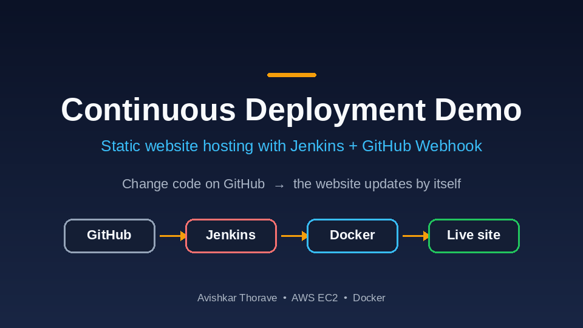

<sub>👆 <b>Live demo:</b> the logo text is changed on GitHub. A few seconds later, Jenkins has rebuilt and republished the website without anyone touching the server.</sub>

</div>

---

## 📑 Table of Contents

1. [The Problem](#-the-problem-in-plain-english)
2. [The Solution](#-the-solution)
3. [Architecture](#-architecture)
4. [Tools Used and Why](#-tools-used-and-why)
5. [How the Automation Works](#-how-the-automation-works)
6. [Demo and Screenshots](#-demo-and-screenshots)
7. [Step-by-Step Implementation](#-step-by-step-implementation)
8. [Test the Automation](#-test-the-automation)
9. [Challenges and What I Learned](#-challenges-and-what-i-learned)
10. [Cost Note and Cleanup](#-cost-note-and-cleanup)
11. [Future Improvements](#-future-improvements)
12. [Use This Project](#-use-this-project-in-your-own-repo)

---

## 🤔 The Problem

Imagine you run a small website, maybe a travel blog. Every time you fix a typo or add a new photo, you have to:

- 😟 Log in to the server
- 😟 Copy the new files across by hand
- 😟 Restart things and hope nothing breaks
- 😟 Repeat this **every single time** you make a change

It is slow, boring, and easy to get wrong. One forgotten step and the live website is broken.

Real companies change their websites **many times a day**. They cannot afford to do it by hand.

## 💡 The Solution

This project shows **how it's done**, using **Continuous Deployment (CD)**: every time you save a change to your code, a robot publishes it for you.

> 📮 **Post office analogy**
>
> Think of a shop owner who writes a new notice and drops it into a **postbox** (GitHub).
> The postbox has a **doorbell** (webhook) wired to a **helper** (Jenkins).
> The moment a notice arrives, the bell rings, the helper picks it up, **prints it nicely**, and **pins it on the shop window** (the live website).
>
> The owner only writes the notice. Everything else happens automatically.

| Term | Simple meaning |
|------|----------------|
| 🐙 **GitHub** | An online folder where your code is saved, with a history of every change |
| 🤖 **Jenkins** | A free "robot helper" that runs a to-do list whenever it is told to |
| 🔔 **Webhook** | A doorbell: GitHub rings it the moment you save a change, so Jenkins wakes up instantly |
| 📋 **Pipeline** | The robot's to-do list, written in a file called `Jenkinsfile` |
| 📦 **Docker** | A sealed box that holds your website and everything it needs, so it runs the same everywhere |
| ☁️ **AWS EC2** | A computer you rent from Amazon and use over the internet |
| 🔁 **CI/CD** | Short for Continuous Integration / Continuous Deployment: testing and releasing every change automatically |

### ✅ Result

**Save a change on GitHub, and the live website is updated in about 7 seconds.** No logins. No file copying. No mistakes from forgotten steps.

---

## 🏗️ Architecture

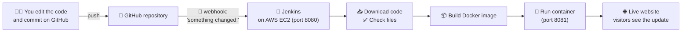

**How to read the diagram (follow the arrows):**

1. 👩‍💻 You change the website files and **commit** (save) them on GitHub.
2. 🐙 **GitHub** receives the change and instantly sends a message, called a **webhook**, to Jenkins.
3. 🤖 **Jenkins**, running on an **AWS EC2** server, wakes up and starts its pipeline.
4. 📦 It downloads the latest code, checks the files, and packs the website into a **Docker image**.
5. 🚀 It starts a fresh **container** from that image.
6. 🌐 Visitors open the server address and see the **updated website**.

---

## 🧰 Tools Used and Why

| Tool | What it is (simple) | Why it's used here |
|------|---------------------|--------------------|
| **GitHub** | Online storage for code | Keeps the website files and rings the webhook doorbell on every change |
| **Jenkins** | An automation robot | Runs the pipeline (download, check, build, deploy, verify) automatically |
| **GitHub Webhook** | A doorbell between GitHub and Jenkins | Starts the build instantly instead of waiting or clicking *Build Now* |
| **Docker** | A sealed box for apps | Packages the website so it runs the same way every time |
| **Nginx** (inside the container) | A lightweight web server | Serves the HTML, CSS and JavaScript files to visitors |
| **AWS EC2** (Ubuntu) | A virtual computer in the cloud | Hosts both Jenkins and the live website |
| **Security Group** | A virtual firewall | Opens only the ports we need (22, 8080, 8081) |
| **Jenkinsfile** | The pipeline written as a file | Keeps the robot's to-do list **inside the project**, so it is saved and shareable |

---

## ⚙️ How the Automation Works

Every time you commit, Jenkins runs these **stages** in order. If any stage fails, the pipeline turns red and stops, so a broken website never goes live.

| # | Stage | 🗣️ In plain English |
|:-:|-------|---------------------|
| 1 | **Checkout Code** | Downloads the newest files from GitHub |
| 2 | **Verify Files** | Checks that the important files (like `index.html`) are really there |
| 3 | **Build Docker Image** | Packs the website into a sealed box (an image) |
| 4 | **Deploy Website** | Removes the old box and starts the new one |
| 5 | **Verify Deployment** | Opens the website to confirm it is really running |

> ⏱️ In this project the whole run takes about **7 seconds**.

---

## 📸 Demo and Screenshots

### 🎬 Before and after: one code change

<table>
  <tr>
    <td align="center" width="50%"><b>🔴 Before</b><br><sub>Logo says <code>ExploreWithUs</code></sub></td>
    <td align="center" width="50%"><b>🟢 After</b><br><sub>Logo says <code>ExploreWithUs_Avishkar</code></sub></td>
  </tr>
  <tr>
    <td>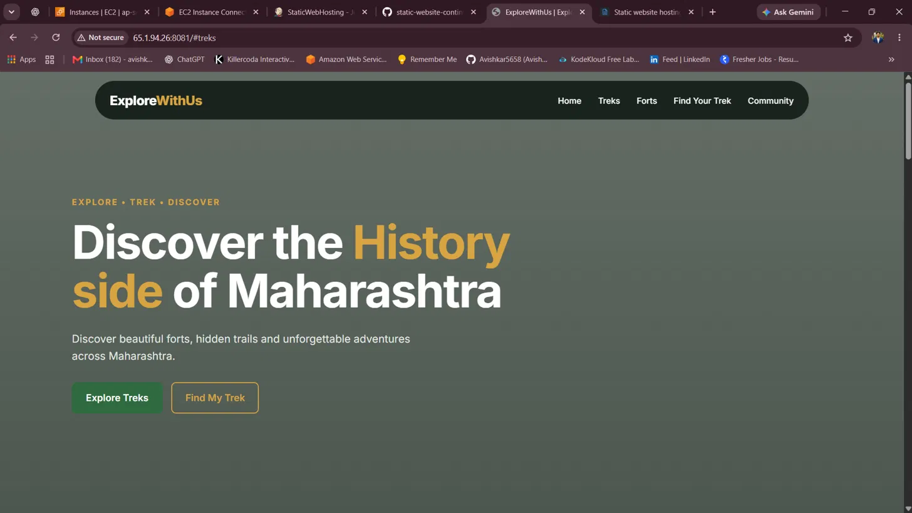</td>
    <td>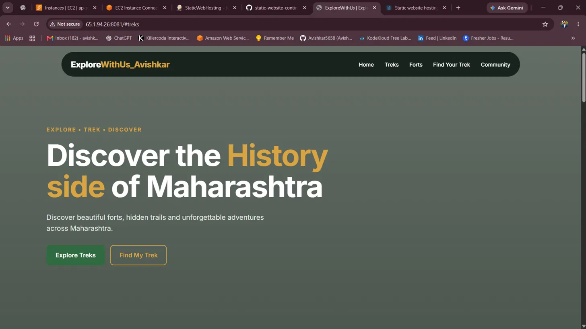</td>
  </tr>
</table>

### ✏️ The only thing done by hand: edit and commit

<table>
  <tr>
    <td align="center" width="50%"><b>Old code</b></td>
    <td align="center" width="50%"><b>New code</b></td>
  </tr>
  <tr>
    <td>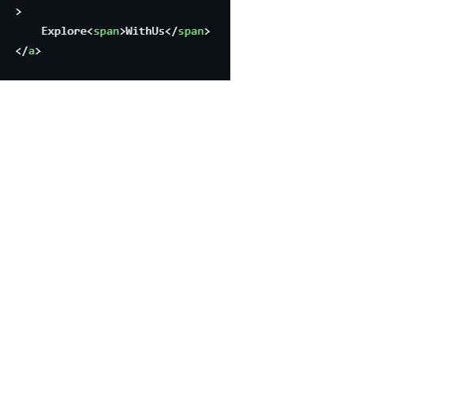</td>
    <td>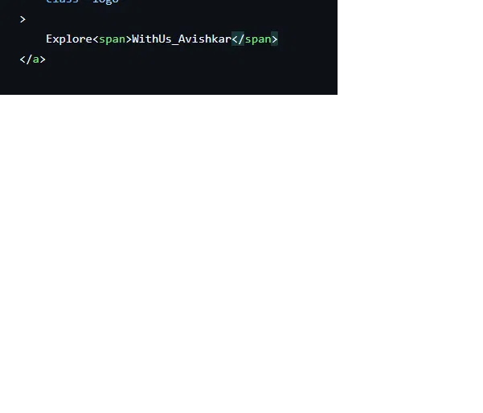</td>
  </tr>
</table>

<div align="center">
  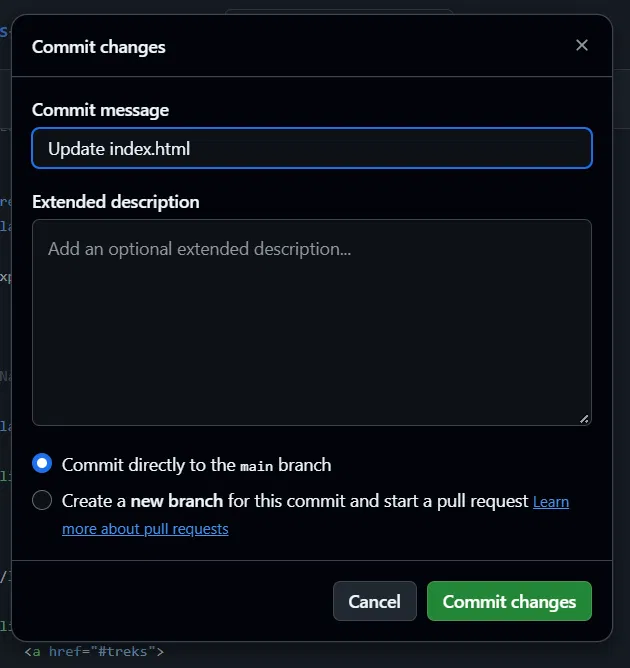
</div>

### 🤖 Jenkins builds it automatically

Every box is green: all stages passed. Builds **#7** and **#8** each started on their own from a single commit.

<div align="center">
  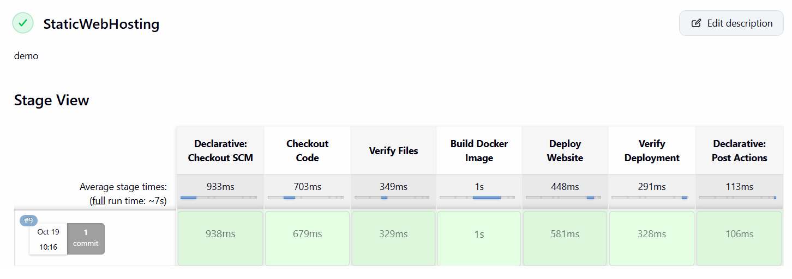
</div>

### 🔔 The webhook doorbell works

A green tick and **Last delivery was successful** mean GitHub can reach Jenkins.

<div align="center">
  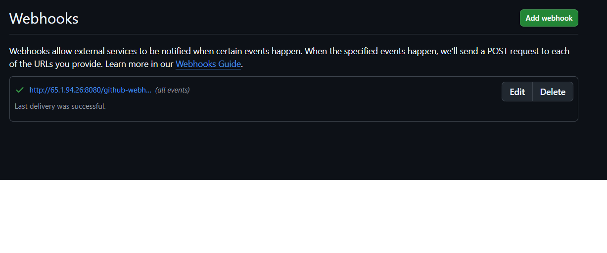
</div>

---

## 🛠️ Step-by-Step Implementation

> 🌎 **Region used:** Asia Pacific (Mumbai), `ap-south-1`. Any region works.

### ✅ Prerequisites

- An [AWS account](https://aws.amazon.com/free/) and a [GitHub account](https://github.com/signup)
- A web browser (nothing needs to be installed on your own laptop)
- About 45 minutes

---

### Step 1️⃣ — Create the server (AWS EC2)

- **Service:** EC2 → Launch instance
- **Name:** `jk-server`
- **AMI:** Ubuntu
- **Instance type:** `t3.small` or larger (Jenkins likes at least 2 GB of memory; this project used `c7i-flex.large`)
- **Key pair:** create one and keep the file safe
- **Security group:** allow these inbound ports

| Port | Used for | Allow from |
|:----:|----------|------------|
| `22` | Logging in to the server (SSH) | Your IP |
| `8080` | Jenkins | Anywhere while testing (see the hardening tip below) |
| `8081` | The live website | Anywhere (`0.0.0.0/0`) |

Wait until the instance is **Running** and the status checks pass.

<div align="center">
  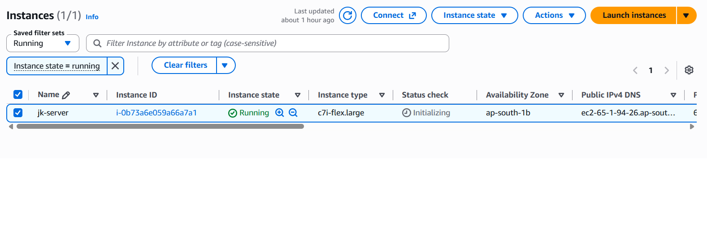
</div>

> 🔒 **Hardening tip:** after testing, restrict port `8080` to GitHub's webhook addresses or your own IP, and add a **webhook secret**.

---

### Step 2️⃣ — Log in and install Jenkins

In the EC2 console choose your instance → **Connect** → **EC2 Instance Connect** → **Connect**. A terminal opens in your browser. Then run:

```bash
# 1. Install Java (Jenkins needs it)
sudo apt update
sudo apt install -y fontconfig openjdk-21-jre
java -version

# 2. Add the official Jenkins source and install it
sudo wget -O /etc/apt/keyrings/jenkins-keyring.asc \
  https://pkg.jenkins.io/debian-stable/jenkins.io-2023.key
echo "deb [signed-by=/etc/apt/keyrings/jenkins-keyring.asc] https://pkg.jenkins.io/debian-stable binary/" \
  | sudo tee /etc/apt/sources.list.d/jenkins.list > /dev/null
sudo apt update
sudo apt install -y jenkins

# 3. Start it
sudo systemctl enable --now jenkins
sudo systemctl status jenkins
```

> ℹ️ Jenkins renews its signing key from time to time. If the key line fails, copy the latest commands from the [official Jenkins install page](https://www.jenkins.io/doc/book/installing/linux/).

Open `http://<YOUR-EC2-PUBLIC-IP>:8080` in your browser and unlock Jenkins with:

```bash
sudo cat /var/lib/jenkins/secrets/initialAdminPassword
```

Choose **Install suggested plugins**, create your admin user, and you will land on the Jenkins dashboard.

---

### Step 3️⃣ — Install Docker and let Jenkins use it

```bash
sudo apt install -y docker.io
sudo usermod -aG docker jenkins
sudo systemctl restart jenkins
sudo -u jenkins -H docker ps
```

✅ If you see a table with `CONTAINER ID`, `IMAGE`, `STATUS` (even with no rows), Docker works for Jenkins.

<div align="center">
  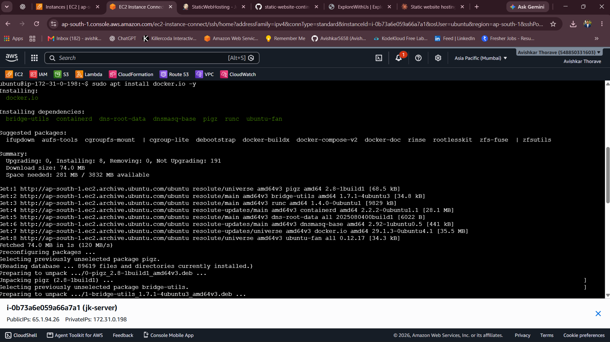
</div>

---

### Step 4️⃣ — Create the GitHub repository

1. On GitHub click **New repository** and name it, for example, `static-website-continuous-deployment`.
2. Choose **Public** and click **Create repository**.
3. Upload your website files plus these two small files:

**`Dockerfile`** (packs the website into a box served by Nginx):

```dockerfile
FROM nginx:alpine
COPY . /usr/share/nginx/html
EXPOSE 80
```

**`Jenkinsfile`** (the robot's to-do list):

```groovy
pipeline {
    agent any
    stages {
        stage('Checkout Code') {
            steps { checkout scm }
        }
        stage('Verify Files') {
            steps { sh 'ls -la && test -f index.html' }
        }
        stage('Build Docker Image') {
            steps { sh 'docker build -t static-site:latest .' }
        }
        stage('Deploy Website') {
            steps {
                sh 'docker rm -f static-site || true'
                sh 'docker run -d --name static-site -p 8081:80 static-site:latest'
            }
        }
        stage('Verify Deployment') {
            steps { sh 'sleep 3 && curl -f http://localhost:8081' }
        }
    }
}
```

---

### Step 5️⃣ — Create the Jenkins pipeline job

1. Jenkins dashboard → **New Item** → name it `StaticWebHosting` → choose **Pipeline** → **OK**.
2. **General:** tick **GitHub project** and paste your repository link.

<div align="center">
  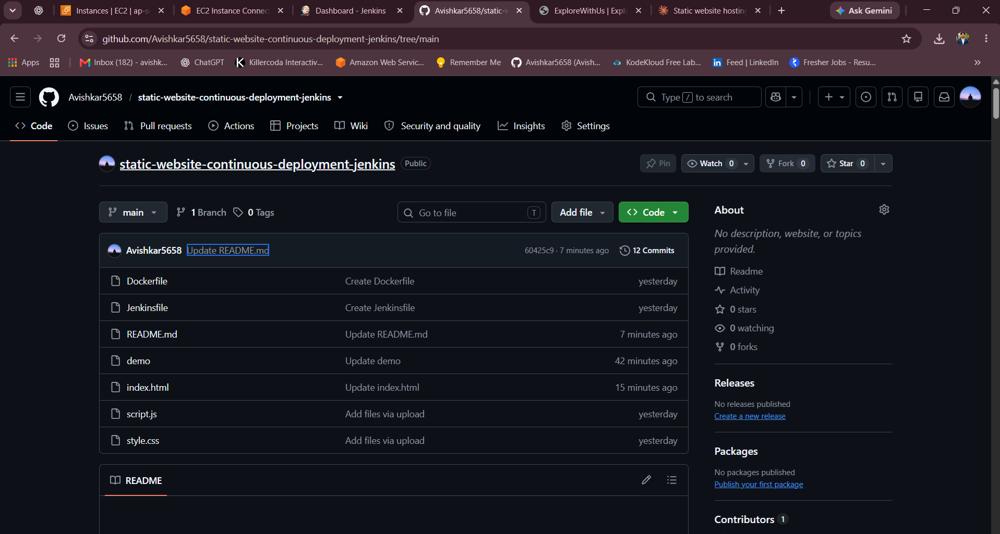
</div>

3. **Triggers:** tick **GitHub hook trigger for GITScm polling** (this is the "listen for the doorbell" switch).

<div align="center">
  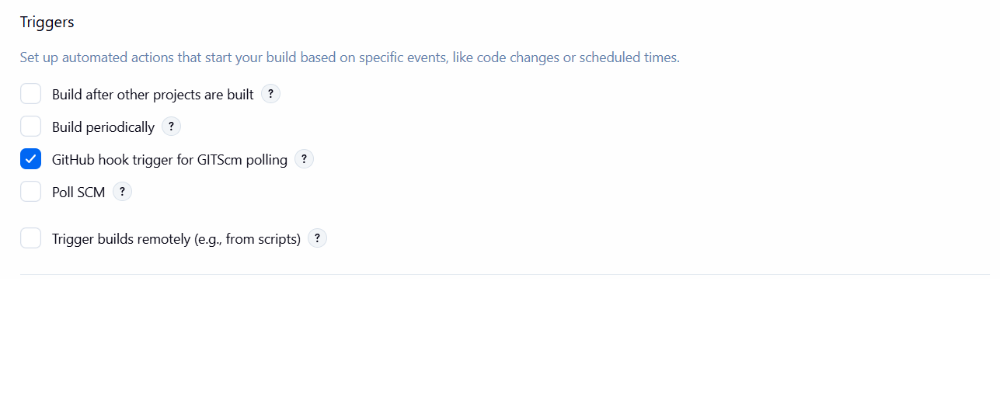
</div>

4. **Pipeline:** choose **Pipeline script from SCM** → **Git** → paste your repository URL. Credentials can stay `none` for a public repo.

<div align="center">
  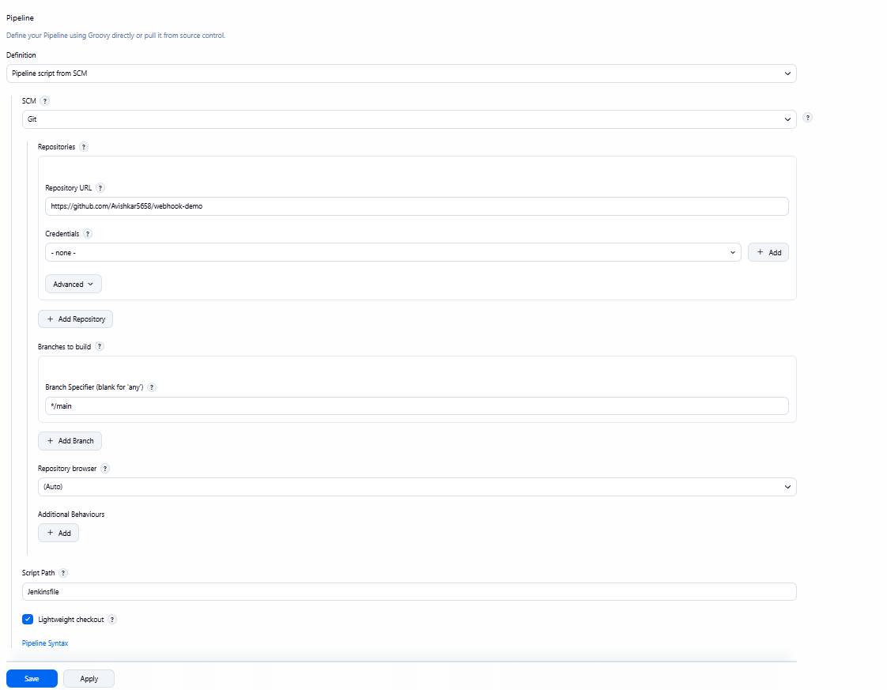
</div>

5. Set **Branch Specifier** to `*/main` and **Script Path** to `Jenkinsfile`, then click **Save**.

<div align="center">
  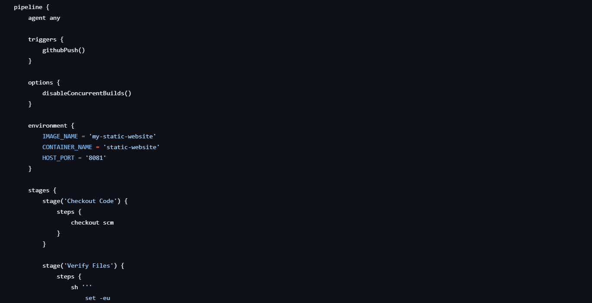
</div>

---

### Step 6️⃣ — Connect GitHub to Jenkins (the webhook) 🔔

1. In your GitHub repository go to **Settings → Webhooks → Add webhook**.
2. **Payload URL:** `http://<YOUR-EC2-PUBLIC-IP>:8080/github-webhook/` (keep the slash at the end)
3. **Content type:** `application/json`
4. Choose **Just the push event** and click **Add webhook**.

GitHub tests it straight away. A **green tick** means the doorbell works ✅

---

## 🧪 Test the Automation

1. Open your repository and edit a file, for example change the logo text in `index.html`.
2. Click **Commit changes** (directly to `main`).
3. Switch to Jenkins. A new build starts **by itself** within a few seconds.
4. Watch the **Stage View** turn green.
5. Open `http://<YOUR-EC2-PUBLIC-IP>:8081` and refresh. Your change is live. 🎉

<div align="center">
  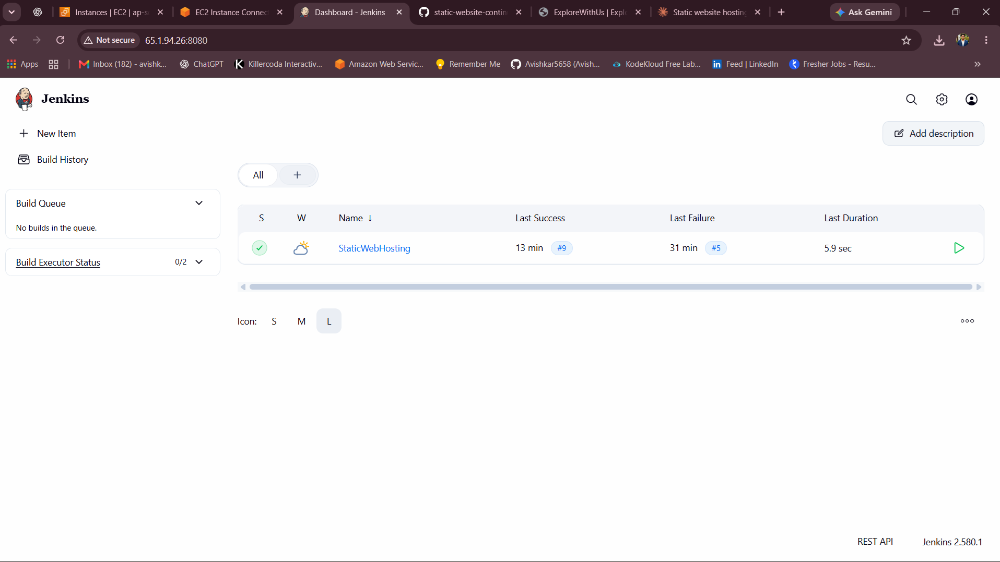
</div>

**Reading the Jenkins screen**

| What you see | What it means |
|--------------|---------------|
| ✅ Green tick | The last build worked |
| ❌ Red cross | The last build failed. Open the build and read **Console Output** |
| 🌤️ Weather icon | How healthy the job has been recently |
| 🟩 Green boxes in Stage View | Each stage passed |

---

## 🎓 Challenges and What I Learned

> ✏️ *Replace the rows below with problems you actually faced. Genuine lessons stand out the most.*

| Challenge | How I solved it |
|-----------|-----------------|
| Early builds failed (build **#5** in the dashboard) | Opened the **Console Output**, fixed the cause and re-ran until every stage was green |
| Jenkins could not run Docker commands (*permission denied*) | Added the `jenkins` user to the `docker` group and restarted Jenkins |
| Builds did not start after a commit | Checked that **GitHub hook trigger** was ticked and the webhook showed a green tick |
| Port `8080` and the website clashed | Ran Jenkins on `8080` and the website on a different port, `8081` |

**Key takeaways**

- ✅ How **CI/CD** removes slow, error-prone manual releases
- ✅ How GitHub, webhooks, Jenkins and Docker work together
- ✅ Why the pipeline lives in a `Jenkinsfile`: it is saved, versioned and reusable
- ✅ How to read build logs and fix a failing pipeline

---

## 💰 Cost Note and Cleanup

This project uses a billable **EC2 instance**. A small instance is covered by the AWS Free Tier only within its limits. Check current prices on the [AWS pricing page](https://aws.amazon.com/ec2/pricing/).

> 💡 **Public IP changes:** if you **stop and start** the instance, its public IP changes. Update the webhook URL on GitHub, or attach an **Elastic IP**.

### 🧹 Clean up when you finish (to avoid charges)

1. Delete the **webhook** in GitHub → Settings → Webhooks
2. **Terminate** the EC2 instance (`jk-server`)
3. Delete the **Security Group** and the **key pair** if you no longer need them

> ⚠️ Always check the AWS Billing dashboard after cleanup.

---

## 🔮 Future Improvements

- [ ] 🔐 Add **HTTPS** with a domain and AWS Certificate Manager
- [ ] 🔑 Protect the webhook with a **secret token**
- [ ] 🧪 Add automatic **tests** before deploying
- [ ] 📤 Push the Docker image to **Docker Hub** or **Amazon ECR**
- [ ] 🔔 Send **Slack or email alerts** when a build fails
- [ ] 🏗️ Create the server automatically with **Terraform**
- [ ] ☸️ Move from a single container to **Kubernetes** or **ECS**

---

## 🔁 Use This Project in Your Own Repo

Want to try it or add it to your own portfolio?

1. **Fork** this repository (top-right button) or download it as a ZIP
2. Follow the [step-by-step guide](#-step-by-step-implementation) in your own AWS account
3. Replace the screenshots in `screenshots/` with **your own**
4. Swap in your own website files (`index.html`, `style.css`, `script.js`)
5. Write your own **Challenges and What I Learned** section
6. ⭐ If it helped you, give the repo a star!

### 📁 Repository structure

```
static-website-continuous-deployment/
├── README.md
├── Dockerfile            # Packs the website into a Docker image (Nginx)
├── Jenkinsfile           # The pipeline: checkout, verify, build, deploy, verify
├── index.html            # The website
├── style.css
├── script.js
└── screenshots/
    ├── demo.gif
    ├── 01-ec2-instance.png
    ├── 02-docker-setup.png
    ├── 03-jenkins-dashboard.png
    ├── 04-github-project.png
    ├── 05-triggers.png
    ├── 06-pipeline-scm.png
    ├── 07-branch-script.png
    ├── 08-webhook.png
    ├── 09-stage-view.png
    ├── code-before.png
    ├── code-after.png
    ├── commit-changes.png
    ├── website-before.png
    └── website-after.png
```

---

## 👤 Author

**Avishkar Thorave**

[](https://github.com/Avishkar5658)
[](https://www.linkedin.com/in/avishkar-thorve-a77a8b2a1)

---

<div align="center">

⭐ **If you found this useful, give it a star!** ⭐

*Built with ☁️ AWS, 🤖 Jenkins and a lot of curiosity.*

</div>
